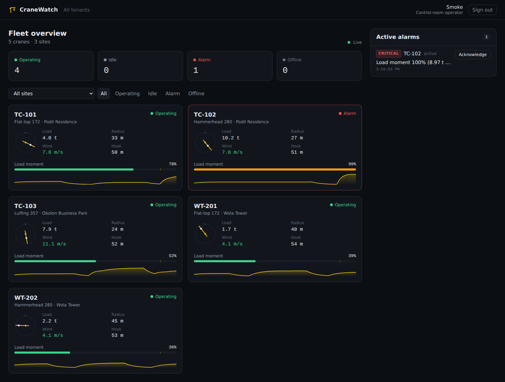
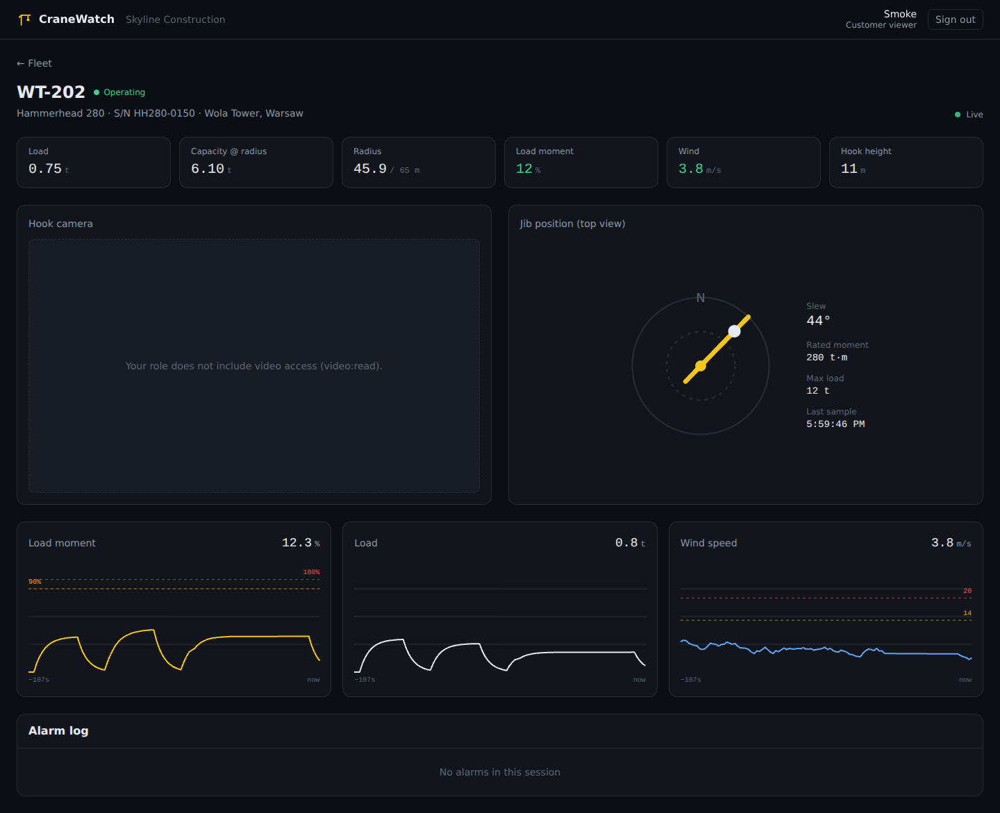
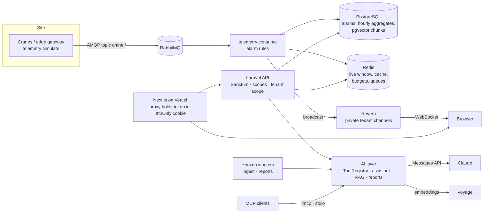

# CraneWatch — AI-first tower crane monitoring

A production-shaped B2B slice: live crane telemetry, alarms, HLS video and multi-tenant access control — plus AI features built the way they need to work in production: grounded in tenant-scoped data, cited, validated, budgeted and measurable.

**Stack:** Laravel 13 API (PHP 8.3+, Sanctum, Reverb, Horizon, `laravel/mcp`, official Anthropic PHP SDK) · PostgreSQL + pgvector · Redis · RabbitMQ · Next.js 15 / React 19 / Tailwind v4 · PHPUnit, Larastan, Pint, Vitest · Docker, GitHub Actions. Deploy targets: **Laravel Cloud** (API) and **Vercel** (web).

| Fleet overview | Crane detail |
| --- | --- |
|  |  |

## What the AI does

| Feature | How it works | What keeps it reliable |
| --- | --- | --- |
| **Assistant** (panel on every page, "Explain" on every alarm) | Claude with 6 tools: fleet status, crane status, hourly stats, alarms, documentation search, acknowledge. Bounded agent loop, streamed to the UI over SSE. | Tools run as the user (scopes + tenant scope); unauthorized tools are never advertised. State changes need a click from the user. Append-only history so prompt caching and replayed thinking stay valid. |
| **RAG over manuals & site documents** | Markdown chunked by headings → embeddings (Voyage, 1024-d) in pgvector + Postgres full-text, merged with reciprocal rank fusion. Answers cite passages as `[D3§2]`, linked to the source section. | Tenant filter is in the SQL. Customers upload their own documents; nobody else can retrieve them. Ingestion is a queued, idempotent job. |
| **Shift reports** | Numbers (lifts, peaks, alarm counts, ack latency) computed in SQL; the model writes summary, risk and recommendations as structured output. | Output validated against the facts (no invented events); identical inputs reuse the earlier report (hash of facts + prompt version + model). |
| **MCP server** | The same tools over MCP: `/mcp` (Streamable HTTP, Sanctum token) or stdio (`php artisan mcp:start cranewatch`). | Same `ToolRegistry::call()` path as the assistant. A narrower token (e.g. read-only) can only reduce what the client sees. |

Cross-cutting: usage ledger (tokens, cache reads, cost, latency, stop reason per call), daily token budget per tenant, per-user AI rate limit, server-side refusal fallback, retries/timeouts, an admin **AI usage** page, and an offline golden-set eval (`php artisan ai:eval`).

**No API key? Everything still runs.** Without `ANTHROPIC_API_KEY` a deterministic mock LLM routes to the same tools and assembles answers from their results; without `VOYAGE_API_KEY` embeddings are feature-hashed. The demo, CI and the test suite use this mode.

## Run it locally

Requirements: PHP 8.3+ (pdo_pgsql, redis, sockets), Composer, Node 22, Docker.

```bash
docker compose up -d postgres redis rabbitmq        # pgvector on :5433, redis on :6390

cd api
composer install && cp .env.example .env && php artisan key:generate
php artisan migrate --seed                            # seeds tenants/cranes/users + 12 h of history
php artisan knowledge:ingest --sync                   # index the bundled manuals
# in separate terminals:
PHP_CLI_SERVER_WORKERS=6 php artisan serve            # API on :8000
php artisan reverb:start                              # WebSockets on :8080
php artisan horizon                                   # queues: default, ai
php artisan telemetry:consume                         # RabbitMQ -> alarms, live state, broadcasts
php artisan telemetry:simulate                        # cranes -> RabbitMQ

cd ../web
npm install && cp .env.example .env.local && npm run dev   # http://localhost:3000
```

Set `TELEMETRY_BUS=sync` to skip RabbitMQ (simulate processes in-process). Add `ANTHROPIC_API_KEY` to `api/.env` for real answers.

Sign in as one of the demo users — each sees different data **and gets different AI answers and tools**:

| User | Role | Tenant | Cranes | Video | Ack | Docs upload | AI usage |
| --- | --- | --- | --- | :-: | :-: | :-: | :-: |
| Olena | `admin` | all | 5 | ✓ | ✓ | ✓ (library) | ✓ |
| Taras | `operator` | all | 5 | ✓ | ✓ | — | — |
| Iryna | `customer_manager` | BudInvest | 3 | ✓ | ✓ | ✓ (own) | — |
| Piotr | `customer_viewer` | Skyline | 2 | — | — | — | — |

Checks:

```bash
cd api && ./vendor/bin/pint --test && ./vendor/bin/phpstan && php artisan test && php artisan ai:eval
cd web && npm run typecheck && npm test && npm run build
```

### Connect an MCP client

```bash
# Claude Code, local stdio, acting as a user:
claude mcp add cranewatch --env MCP_LOCAL_USER=operator@demo.io -- php /path/to/api/artisan mcp:start cranewatch

# Remote: get a read-only token and use it as a bearer header
curl -s localhost:8000/api/auth/login -H 'Content-Type: application/json' \
  -d '{"email":"manager@budinvest.demo","name":"mcp","abilities":["cranes:read","telemetry:read","alarms:read","docs:read"]}'
claude mcp add --transport http cranewatch http://localhost:8000/mcp --header "Authorization: Bearer <token>"
```

## Architecture



```
api/                         Laravel API
  app/Domain                 Role -> Scope bundles, enums
  app/Auth, Models/Concerns  TenantContext + BelongsToTenant global scope (isolation in one place)
  app/Telemetry              simulator (ported from TS, bit-identical PRNG), AlarmEngine, processor, RabbitMQ/sync bus
  app/Ai/Llm                 LlmClient: AnthropicLlmClient, FakeLlmClient
  app/Ai/Tools               tools + ToolRegistry (shared by assistant and MCP)
  app/Ai/Assistant           agent loop, prompts (versioned)
  app/Ai/Knowledge           chunker, embeddings, hybrid search
  app/Ai/Reports             facts (SQL), schema + validation
  app/Mcp                    MCP server and tool adapter
  resources/knowledge        bundled manuals; tenants/{id}/ for customer documents
  resources/evals            golden sets for ai:eval
web/                         Next.js app (UI only; all data and authorization from the API)
  src/app/api/backend        same-origin proxy: adds the user's token, streams SSE
  src/lib/realtime           Reverb (Pusher protocol) transport + pure reducer store
  src/components/assistant   assistant panel, SSE client, safe Markdown renderer
docs/adr                     decisions and their trade-offs
```

## Working on this repo with AI agents

The repo is set up for Claude Code (and other agents via `AGENTS.md`):

| Piece | Where | What it does |
| --- | --- | --- |
| Project instructions | `AGENTS.md` (shared standard), `CLAUDE.md` (imports it + Claude specifics) | Commands, invariants, workflow — loaded every session |
| Rules | `.claude/rules/*.md` | Path-scoped conventions (Laravel API, AI layer, database, tests, web) — load only when matching files are touched |
| Skills | `.claude/skills/*` | Procedures: `/verify`, `/add-ai-tool`, `/add-api-endpoint`, `/ai-eval`, `/prompt-change`, `/dev-stack`, `/deploy-check` |
| Subagents | `.claude/agents/*` | `tenant-security-reviewer`, `ai-quality-reviewer` (read-only), `laravel-test-writer` |
| Hooks | `.claude/settings.json` + `.claude/hooks/` | Pint after PHP edits; block edits to `.env`, lock files and committed migrations; local stack status at session start |
| Permissions | `.claude/settings.json` | Checks run without prompts; migrations/pushes ask; `migrate:fresh`, force-push and reading `.env` are denied |
| MCP | `.mcp.json` | `cranewatch` (this app's own tools, as the operator user) and `laravel-boost` (schema, queries, logs, Laravel docs) |

Personal overrides go in `.claude/settings.local.json` and `CLAUDE.local.md` (gitignored).

## Deploy

**API → Laravel Cloud.** Point the app at this repository with `api/` as the application root (if the root can't be set in your plan, move `api/` to the repo root — nothing in it depends on its location). Resources: Serverless Postgres (enable `vector`), Key-Value store (Redis-compatible), Reverb WebSocket cluster. RabbitMQ isn't a managed resource there: use CloudAMQP and set `RABBITMQ_URL=amqps://…`, or run with `TELEMETRY_BUS=sync`.
- Deploy commands: `php artisan migrate --force`, `php artisan db:seed --force`, `php artisan knowledge:ingest`
- Background processes: `php artisan horizon`, `php artisan telemetry:consume`, `php artisan telemetry:simulate`
- Env: `APP_KEY`, `ANTHROPIC_API_KEY`, `VOYAGE_API_KEY` (optional), `AI_DAILY_TOKEN_BUDGET`, `RABBITMQ_URL`, `TELEMETRY_BUS`; DB/KV/Reverb variables are injected by the resources.

**Web → Vercel.** Root directory `web`. Env: `API_URL=https://<app>.laravel.cloud/api`, `NEXT_PUBLIC_REVERB_KEY/HOST/PORT/SCHEME` from the Reverb cluster. The browser only talks to Vercel (pages + `/api/backend/*` proxy) and to Reverb, so the API needs no CORS.

Troubleshooting:

| Symptom | Check |
| --- | --- |
| Stuck on "Connecting…", no Live badge | Vercel domain missing from the Reverb app's **Allowed origins**, or wrong `NEXT_PUBLIC_REVERB_*` |
| Live, but values don't change | `telemetry:simulate` not running, or the app cluster is hibernating |
| Reports/documents stay `queued`/`pending` | No `horizon` process, or `QUEUE_CONNECTION` isn't `redis` |
| Postgres `too many clients` | Use the `-pooler` host in `DB_HOST` |
| Vercel: `NEXT_NO_VERSION` | Root Directory isn't set to `web` |
| Background processes run twice | App cluster has more than one replica — background processes run on every replica |

## After launch

What to watch: the **AI usage** page (cost per tenant, cache hit rate, p95 latency, `refusal`/`max_tokens` stop reasons), failed jobs in Horizon (reports that didn't validate, ingestion failures), and `ai.tool` log lines (tool, user, ok, ms). Before changing a prompt, tool description, chunking or model, run `php artisan ai:eval` and compare.

Known limits / next steps: alarm hysteresis (wind hovering around a threshold raises and clears repeatedly — visible in the seeded history), Entra ID/OIDC instead of the demo sign-in, a time-series store for raw telemetry, multi-consumer processing (the consumer caches open alarms in memory), Playwright E2E for the role matrix, and an LLM-graded eval with a real key.
